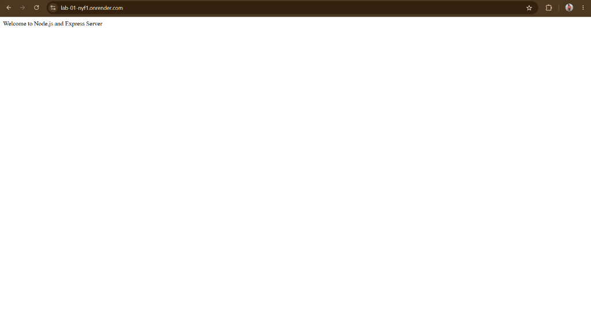
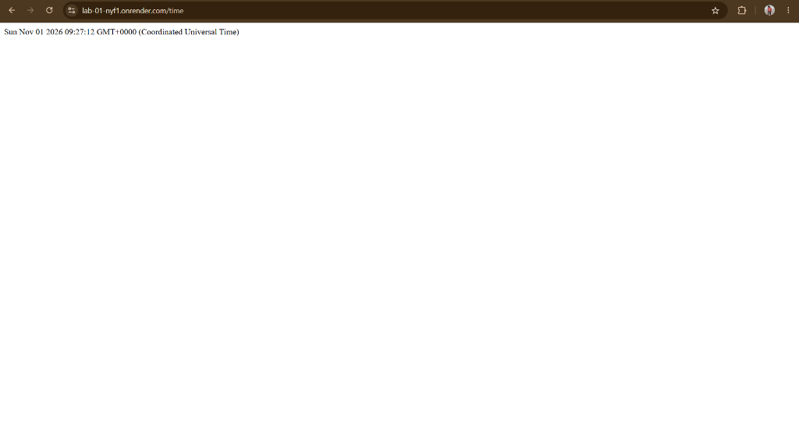

# LAB-01
# Lab 1: Node.js and Express Server

**Student Name:** Sai Ram    
**Section:** CSE(GEN)-AI-2B

## Project Description

This project demonstrates how to create a web server using Node.js and Express.js. It includes a basic HTTP server, Express server, GET routes, and 404 error handling.

## Technologies Used

- Node.js
- Express.js
- JavaScript
- npm

## Installation

Clone the repository:

```bash
git clone YOUR_GITHUB_REPOSITORY_URL
```

Navigate to the lab folder:

```bash
cd lab-01
```

Install dependencies:

```bash
npm install
```

## How to Run

### 1. HTTP Server

```bash
node server.js
```

Open: `http://localhost:3000`

### 2. Express Server

```bash
node app.js
```

## API Endpoints

| Method | Endpoint | Description |
|---|---|---|
| GET | / | Welcome message |
| GET | /about | Student information |
| GET | /time | Current date and time |
| GET | /contact | 404 error response |

## Expected Status Codes

- 200 – Successful request
- 404 – Page not found

## Screenshots

## Screenshots

### 1. Home Page


### 2. About Page


### 3. Current Date and Time


### 4. 404 Error Page


## Problems Faced and Solutions

- Faced difficulties setting up the Node.js project.
- Solved them using npm initialization and Express installation.
- Tested all routes to verify correct responses.

## Conclusion

Successfully created a basic web server using Node.js and Express.js and implemented GET routes with proper HTTP status codes.
