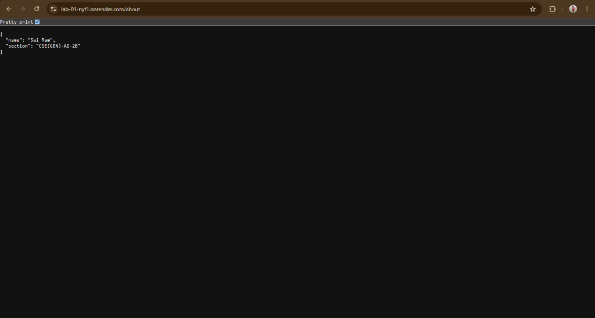
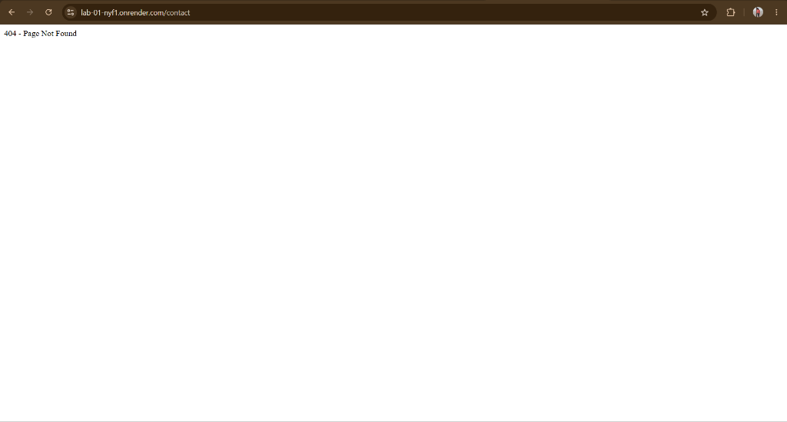

# LAB-01 – Node.js and Express Server

A simple Node.js and Express server project demonstrating HTTP server creation, Express routing, and error handling.

## Live Deployment

🌐 **Live URL:** [https://lab-01-nyf1.onrender.com](https://lab-01-nyf1.onrender.com)

## Author

- **Name:** Sai Ram
- **Section:** CSE(GEN)-AI-2B

## Project Structure

```
LAB-01/
│
├── app.js              # Express server with routes and 404 handling
├── server.js           # Basic Node.js HTTP server
├── package.json        # Project metadata and dependencies
├── package-lock.json   # Dependency lock file
├── .gitignore          # Git ignore rules
├── README.md           # Project documentation
│
└── screenshots/        # Output screenshots
    ├── lab01-home-page.png
    ├── lab01-about-page.png
    ├── lab01-time-page.png
    └── lab01-404-page.png
```

## Installation

1. Clone the repository:
   ```bash
   git clone https://github.com/sairam-142008/LAB-01.git
   cd LAB-01
   ```

2. Install dependencies:
   ```bash
   npm install
   ```

## Usage

### Task 1 – Node.js HTTP Server

```bash
node server.js
```

Runs a basic HTTP server using the built-in `http` module on **port 3000**.

### Task 2, 3, 4 – Express Server with Routes

```bash
node app.js
```

Runs an Express server on **port 3000** (or `process.env.PORT` on cloud host) with the following routes:

## API Endpoints

| Method | Route    | Description                     | Live Link |
|--------|----------|---------------------------------|-----------|
| GET    | `/`      | Returns a welcome message       | [Open Endpoint](https://lab-01-nyf1.onrender.com/) |
| GET    | `/about` | Returns student info as JSON    | [Open Endpoint](https://lab-01-nyf1.onrender.com/about) |
| GET    | `/time`  | Returns the current date & time | [Open Endpoint](https://lab-01-nyf1.onrender.com/time) |
| *      | `/*`     | Returns 404 – Page Not Found   | [Open Endpoint](https://lab-01-nyf1.onrender.com/contact) |

## Screenshots

### 1. Home Page


### 2. About Page


### 3. Current Date and Time


### 4. 404 Error Page


## Dependencies

- [Express](https://expressjs.com/) v5.3.0

## License

ISC
